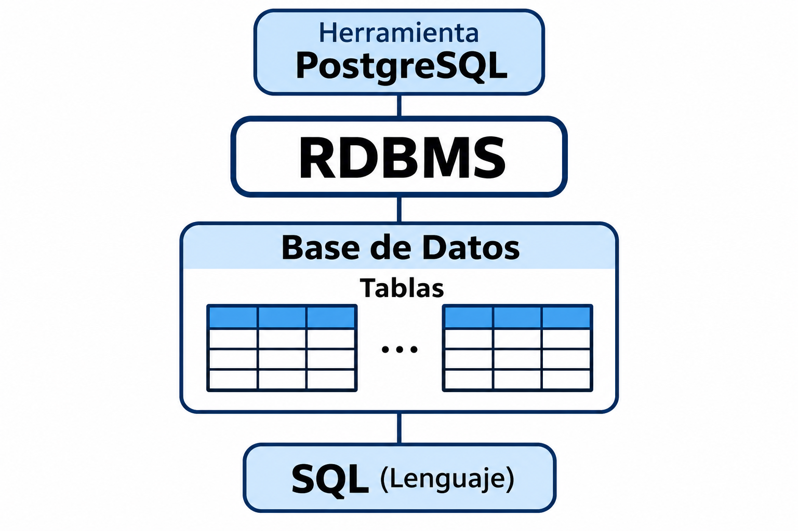

# Tipos de DBMS

## ¿Que es un DBMS? (Database Management System)
- Create
- Manage 
- consult
- modify
- protect

## diferencia entre una database y un DBMS
 La base de datos es un conjunto de datos Organizado.
 EL DBMS es la herramienta o software que los maneja.

 ## Funciones principales de una DBMS
 - Almacenar datos y permitir consultarlos o modificarlos
 - Controlar acceso de los usuarios
 - Mantener la Integridad
 - manejar respaldos y recuperacion

 ## Como interactuan los usuarios y las aplicaciones con un DBMS?
 Con Consultas y comandos casi siempre usando SQL; este resive ordenes las verifica y ejecuta.

 ## Responsabilidades de un DBMS 
  ### Almacenamiento 
  Se encarga de como se guarda fisicamente y de organizar los archivos, indices y paginas para acceder rapido.

  ### Seguridad
  Controla quien entra, que puede ver o cambiar; usando usuarios, contraseña, roles y permisos.

  ### Concurrencia
  Garantiza que muchas personas trabajando al tiempo no se pisen entre si, evitando conflictos con bloqueos o control de versiones.

  ### Recuperación de Datos
  Si falla el sistema se puede volver a un estado consistente, usando respaldos, logs y mecanismos de recuperacion.

 ## Clasificacion
  ### Relational RDBMS 
   Organiza los datos en tablas relacionadas mediante claves, filas y columnas; por ejemplo: postgreSQL, MySQL, Oracle Database, Microsoft SQL Server.

   
  ### Document DBMS
   Almacena información en documentos como XML, Json o Bson; por ejemplo: MongoDB y CouchDB.

  ### Key value DBMS
   Almacena pares de claves y valor como por ejemplo: Redis, AMAZON DYNAMO DB.

  ### Graph DBMS
   Organiza datos mediante nodos, relaciones y propiedades como por elemplo: Neo4j, y AMAZON NEPTUNE.

  ### Wide column DBMS
   Almacena datos en familias de columnas, y esta diseñado para grandes volumenes de información distribuida por ejemplo: apache cassandra o Hbase.

  ### Time Series DBMS
   Especializado en datos asociados a fechas y horas, como metricas, sensores y registros de monitoreos por ejemplo: InfluxDB, TimeScale DB

  ### Object oriented DBMS (OODBMS)
   Almacena y gestiona la información como objetos, tal como se utilizan en la programación orientada a objetos. ejemplos: ObjectDB, GemStone/S, ZODB, Perst, db4o.
  ### Hierarchical DBMS
   Base de datos jerárquica es un tipo de sistema de gestión que organiza la información en una estructura de árbol invertido, donde cada registro hijo tiene exactamente un padre, permitiendo relaciones de uno a muchos pero no de muchos a muchos.
   #### IBM IMS: 
   El sistema más utilizado en entornos de banca, telecomunicaciones y salud por su alto rendimiento en transacciones (OLTP) y fiabilidad en sistemas heredados.
   #### Windows Registry: 
   La base de datos interna de configuración del sistema operativo Microsoft Windows, que estructura claves, subclaves y valores en forma de árbol. ⁠
   #### DNS (Domain Name System): 
   El directorio de nombres de internet, que opera como un árbol global con servidores raíz en la base y entradas individuales en las hojas. ⁠
   #### Active Directory y LDAP: 
   Sistemas de directorios utilizados en redes empresariales para organizar jerárquicamente usuarios, equipos y recursos de forma subordinada. ⁠
   #### Sistemas de archivos: 
   Como NTFS o HFS+, que organizan directorios y archivos siguiendo estrictamente una jerarquía padre-hijo.
  ### Network DBMS
   Son sistemas que organizan la información en una estructura de grafo donde los registros (nodos) se conectan mediante punteros que permiten relaciones muchos a muchos.
   #### IDMS (Integrated Database Management System): 
   Muy utilizado en entornos mainframe y sistemas IBM z Systems para procesamiento de transacciones de alto volumen.
   #### IMS (Information Management System):
   Desarrollado por IBM, es fundamental en sectores como banca y finanzas por su eficiencia en sistemas OLTP.
   #### TurboIMAGE: 
   Diseñado para sistemas HP 3000, optimizado para el procesamiento eficiente de datos empresariales. ⁠
   #### UNIDATA/UniVerse: 
   Un sistema multidimensional que soporta estructuras de red junto con organización multidimensional, usado en manufactura y salud. ⁠
   #### Integrated Data Store (IDS): 
   El sistema pionero creado por Charles Bachman que formalizó el modelo de red.

  ### New SQL
  Son un tipo de sistema de gestión de bases de datos relacional moderno que combina la escalabilidad horizontal y el alto rendimiento de las bases de datos NoSQL con las garantías de consistencia ACID y el lenguaje SQL de los sistemas relacionales tradicionales, por ejemplo, CockroachDB, Google Spanner, ⁠VoltDB, NuoDB, SingleStore, Tidb

  ### In memory DBMS
  son sistemas de gestión que almacenan y procesan datos principalmente en la memoria principal (RAM) en lugar de discos duros, lo que permite un acceso a datos ultrarrápido y latencia mínima.
  Redis, SAP HANA, Apache Ignite, Aerospike, Oracle TimesTen, Amazon MemoryDB, Volt Active Data
 ## ¿Que debe analizar un DBA al elegir o administrar un DBMS?
 - Tipos de datos
 - Volumen
 - Rendimiento
 - Costos
 - Escabilidad
 - Seguridad
 - Soporte proveedor
 Administración
 - backup
 - monitoreo
 - parches de seguridad
 - optimizacion consultas
 - Capacidad para crecer.
 

